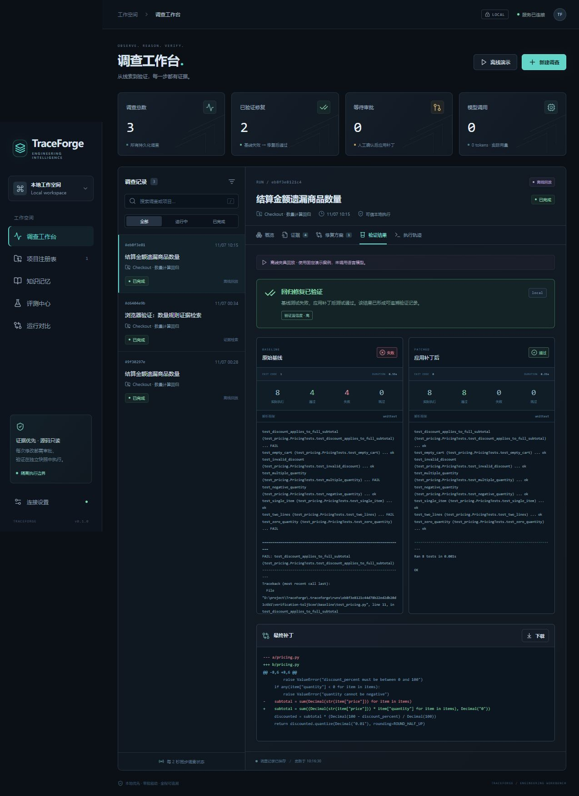
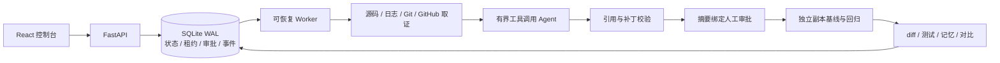

# TraceForge

**把失败日志变成可检查的证据、可审批的补丁和实际执行的回归结果。**

TraceForge 是面向维护多个代码仓库的开发者的本地 Agent 工作台。注册一个仓库，提交异常现象，Agent 可以检索源码、读取准确行号、参考 Git 与可选的 GitHub 信息，提出附带引用的最小修复。你审阅补丁后，验证器在独立副本中运行修复前后的测试，保存差异、退出码、测试数量和完整事件轨迹。

项目支持真实 OpenAI 兼容工具调用，同时提供明确标记的离线样例。离线回放不会被计为模型调用，也不能证明模型修复能力。



本次已验证后端 **455 项通过**、Docker 中结算样例从 **4 项失败 → 8 项通过**，并通过 wheel 独立安装验收；真实模型服务生成仍受 403/429/超时阻塞，完整证据和限制见 [验收记录](docs/acceptance.md)。

## 可以现场演示什么

- 输入一个结算金额异常，看到代码、测试和业务约束的证据引用。
- 审批固定 SHA256 摘要的补丁，观看真实测试由 4 项失败变为 8 项通过。
- 对比两次运行的模式、状态、工具轨迹、Token、耗时和验证结果。
- 在审批等待时重启服务，继续同一个任务；旧 worker 丢失租约后不再允许写状态。
- 尝试修改测试、访问敏感路径、提交过期或重复审批，观察服务端实际拒绝。
- 执行离线机制评测，分别查看验证、权限、检索新鲜度和持久化结果。
- 下载 Markdown 或 JSON 调查报告，带走证据索引、审批摘要和真实测试结果，用于复盘与现场讲解。

## 快速启动（Windows）

从源码运行需要 Python 3.11+、Node.js 22+、uv。在仓库目录执行：

```powershell
uv sync --extra dev
cd web
npm ci
npm run build
cd ..
.venv\Scripts\python.exe -m traceforge serve
```

打开 `http://127.0.0.1:8710`，点击“离线演示”，审阅后批准补丁。演示运行的是仓库内可信的合成 Python 服务，不需要 API Key 或 Docker。测试前后都在副本中运行，原始样例持续保持有缺陷的状态，便于重复演示。

macOS/Linux 的启动命令为 `.venv/bin/python -m traceforge serve`。项目包含对应 CI 配置，但请以实际运行结果为准。

也可以安装已构建的 `dist/traceforge_agent-0.1.0-py3-none-any.whl`。wheel 内含前端、演示和十个基准案例；安装后的用户无需 Node.js 或源码目录。构建、独立安装和复现步骤见 [发布包说明](docs/release.md)。这不包含 Python 解释器、Docker 或第三方 Python 依赖，依赖仍由安装器解析安装。

## 接入自己的仓库

在启动服务的 shell 中明确配置允许访问的根目录，再到“项目注册表”填写路径和测试命令参数数组：

```powershell
$env:TRACEFORGE_ALLOWED_ROOTS = '["D:/project/my-service"]'
.venv\Scripts\python.exe -m traceforge serve
```

测试命令示例：`["python", "-m", "unittest", "discover", "-v"]`。命令用参数数组执行，不经 shell 拼接。

默认选择 Docker。镜像需预先包含项目的测试依赖；验证时禁用网络。Docker daemon 不可用会明确失败，不会自动降级到本机。可信仓库可以显式选择 local；**本机进程不是安全沙箱**，它适合自己维护且信任的代码，不适合运行未知仓库。

仓库索引过滤 `.git`、依赖、构建产物、敏感路径、二进制和链接。默认最多 1,200 个文本文件、单文件 250KB。Git 取证仅支持根目录内独立的普通 `.git` 目录；linked worktree、submodule gitfile、共享对象库和外指元数据会跳过 Git 取证，源码检索仍可使用。

## 真实模型配置

密钥仅从服务端环境读取，不提交到仓库：

```powershell
$env:TRACEFORGE_BASE_URL = 'https://your-compatible-provider/v1'
$env:TRACEFORGE_API_KEY = '<在本机设置>'
$env:TRACEFORGE_MODEL = '<该服务实际支持的模型>'
$env:TRACEFORGE_API_STYLE = 'responses' # 或 chat
.venv\Scripts\python.exe -m traceforge serve
```

先运行 `.venv\Scripts\python.exe -m traceforge doctor` 检查依赖与模型列表；加 `--smoke` 会发起一次最小生成请求，可能产生服务费用。列表中存在模型只证明它被列出，不能证明生成或 Function Calling 可用。不要在启动脚本或仓库文件中填写密钥。

模型服务需要支持 Function Calling。系统提供 `search`、`read`、`finish` 三个工具，限制步数、总时间、上下文和实际 Token 用量。拒绝未知工具、无效参数和不存在的引用。模型不能指定任意执行命令。

仓库材料和输入日志会作为证据发送到你配置的服务，接入真实私有工程前请选择合适的服务和范围。当前工作区的 live smoke 只使用项目自带合成样例；服务返回过 403、429 和网络超时，这些被记录为失败，未当作成功演示。

## 模式与成功口径

| 模式 | 做什么 | 能证明什么 |
| --- | --- | --- |
| `replay` | 仅对固定指纹的内置样例回放预设候选补丁，真实执行测试 | 工作流与验证器可用；不证明模型能力 |
| `investigate` | 对真实仓库做检索与只读取证，不调用模型 | 检索和证据展示；不宣称已确认根因 |
| `live` | 真实模型自主调用工具并提交结构化诊断 | 单次模型行为可追溯；还需独立任务集评价可靠性 |

“已验证修复”要求原测试确实失败、补丁后通过、测试身份集合不减少且原先执行的测试不被跳过。仓库外的观察器支持 `python -m unittest`、`python -m pytest` 和 `pytest` 命令；使用实际 runner/plugin 的结果生成独立完成报告，stdout 只用于展示。前后都通过、零测试通过、缺失观察报告或未知命令都不算已验证修复。

受支持测试命令采用有限参数解析：仓库内的绝对测试路径会映射到副本，越界路径、导入控制参数与不受支持的选项明确失败。pytest 配置中的源码路径应指向快照内相对目录；例如 `pythonpath = src`。观察器检查实际项目模块和测试定义来源，editable 安装导回原仓库时不会记作验证通过。第三方测试依赖需预装到验证环境。

观察器已阻断“打印假成功摘要后 `os._exit(0)`”的复现样例；它与被测 Python 代码仍处于同一解释器，不提供抵御任意反射/猴子补丁的密码学证明。测试也不保证覆盖全部缺陷。普通仓库执行注册的测试命令；内置 benchmark 额外运行预设隐藏测试，用于进一步检验过拟合。

成功记录可以保存为项目内的修复记忆，供人审阅。目前不自动注入旧记忆进行推理，避免把过期引用作为新任务证据。

## 验证与评测

```powershell
.venv\Scripts\python.exe -m pytest -q
.venv\Scripts\python.exe -m traceforge evaluate
.venv\Scripts\python.exe -m traceforge retrieval-evaluate
.venv\Scripts\python.exe -m traceforge benchmark --mode oracle
# 已配置可用模型且 Docker 就绪后，可先执行单个真实模型案例：
.venv\Scripts\python.exe -m traceforge benchmark --mode live --case unit_conversion
cd web
npm run build
```

`evaluate` 的分母是离线机制测试，不是 LLM 修复准确率。它覆盖正确补丁、过拟合补丁、无需修复的基线、测试文件保护、路径边界、可信执行、证据更新删除、租约恢复和审批绑定。结果保存在 `.traceforge/evaluation.json`。

真实模型、离线机制和多故障基准必须分别报告。不要把固定候选补丁的通过率写成“Agent 成功率 100%”。具体限制见报告内的 `limitations`。

## 架构



检索采用 BM25 + 字符 n-gram TF-IDF cosine + RRF，明确属于词法混合检索，不冒充神经向量。独立取证任务并行执行；核心模型当前是单 Agent，不为增加名词而堆模型角色。

检索消融使用 10 个问题、33 个公开文件，移除题面同文和隐藏答案，并加入字母排序对照。实测 RRF 的 Recall@8 为 1.00，BM25 为 0.95；BM25 的 MRR 更高（0.6333 对 0.5833）。这个小规模结果展示覆盖与前排排序的取舍，详见 [检索消融](docs/retrieval-evaluation.md)。

SQLite 的事务与租约适用于单机多 worker。系统是可重入的至少一次处理：崩溃可能重复模型请求或验证副本；没有自动推送、部署或源仓库写入等外部副作用。尚未提供分布式队列、多租户 RBAC 或生产级集群部署。

更多说明：

- [架构与取舍](docs/architecture.md)
- [现有项目审计与选题依据](docs/project-audit.md)
- [实测验收与未完成项](docs/acceptance.md)
- [多故障基准口径](docs/benchmark.md)
- [检索消融与逐案例排名](docs/retrieval-evaluation.md)
- [面试讲解与追问](docs/interview-playbook.md)
- [按一次调查读懂源码与动手练习](docs/code-tour.md)
- [现场演示流程](docs/demo-script.md)
- [接口与模块契约](docs/implementation-contract.md)
- [发布包与独立安装验收](docs/release.md)
- [调查报告格式与口径](docs/reports.md)
- [本机并发一致性验收](docs/local-concurrency.md)
- [配置模板](.env.example)

## 目录

```text
traceforge/       API、持久状态、工具 Agent、检索、执行与评测
web/              React + TypeScript 控制台
examples/         固定的可重复故障演示
tests/            单元、权限、恢复和集成测试
benchmarks/       独立多故障基准与隐藏回归
docs/             架构、项目审计与演示材料
.traceforge/      本机运行数据，已被 Git 忽略
```

TraceForge 的源码在本次工作中独立编写。此前项目只做只读审计，没有复制旧项目源码，也不把第三方框架或书籍实验算作本项目原创成果。
