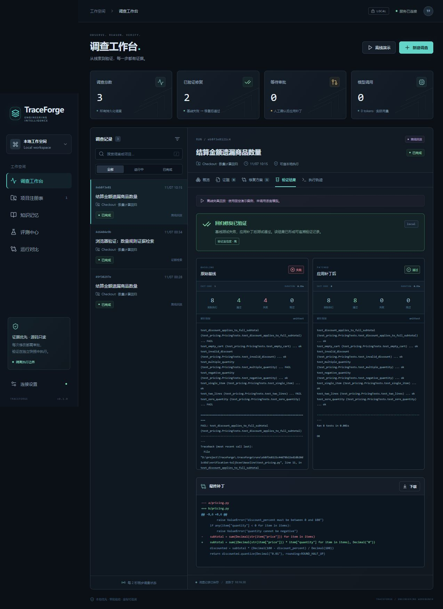
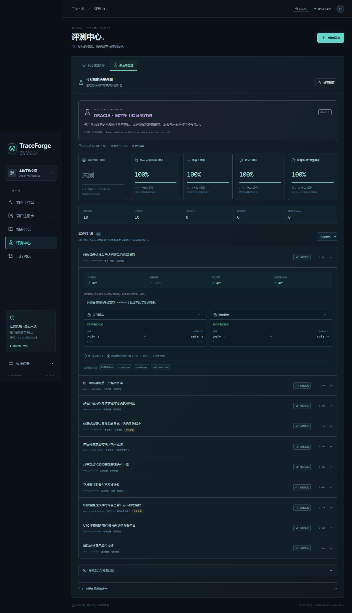

# TraceForge 本次验收记录

截至 **2026-11-07（Asia/Shanghai）**，本机工作流、隔离验证、持久恢复和前端已经完成实测；**真实模型成功修复仍未验收通过**，原因是已配置服务的生成请求返回 403、429 或超时。此项与离线机制成绩分开记录。

环境：Windows 10、Python 3.12.10、Node 22、Docker daemon 29.6.2、`python:3.12-slim`。下面为执行结果，不能解释为其他操作系统、生产负载或企业使用效果。

| 检查 | 实际结果 | 原始记录或复现入口 |
| --- | --- | --- |
| 完整后端测试 | **235 passed, 3 skipped**，63.89s；3 项因本机 symlink 创建权限跳过；实际 Windows junction 测试通过 | 本机 `.traceforge/acceptance/pytest-release.txt`；`python -m pytest -q` |
| Ruff | `All checks passed!` | `python -m ruff check traceforge tests` |
| 锁定安装 | `uv sync --extra dev --locked` 成功 | `uv.lock`；跨磁盘安装使用 copy 回退，仅性能提示 |
| 前端类型检查与构建 | 成功，1585 modules；JS gzip 94.56KB | `npm run build`；不等同于浏览器性能评分 |
| wheel / sdist 内容 | 前端、结算样例、十个基准共 81 个资源；与源码逐文件 SHA256 一致 | `uv build`；已独立只读核查产物 |
| wheel 独立安装 | 空工作目录、独立 venv、Python `-I`；实际 HTML/JS/CSS 可用；摘要审批后 8 项中 4 失败 → 8 项全通过；安装资源不变；evaluate 10/10，unit_conversion oracle 1/1 | [可携带报告](evidence/installed-release.json)；本机 `.traceforge/release-acceptance/report.json`；17.469s，0 模型调用 |
| 一键发布脚本 | `scripts/release.ps1 -SkipInstall` 实跑成功；重新构建前端/sdist/wheel、新建 venv、安装与完整 smoke，后者 12.516s | 本机 `.traceforge/releases/40a8c701d8c34116a7eaa795015a41df/report.json` |
| 离线机制评测 | **10/10** | [可携带报告](evidence/offline-evaluation.json)，`traceforge evaluate` |
| 多故障 Oracle | 修复 **7/7**，拒答 **3/3**，安全 **2/2**，初始检索路径覆盖 **10/10** | [可携带报告](evidence/oracle-benchmark.json)，session `20261107T024936Z-b0e64e03` |
| 模型功能正确率 | **未测，0/0**；Oracle provider calls=0、tokens=0 | 与上一行完全不同的分母 |
| 真实 Docker 验证 | baseline exit 1，8 项中 4 失败；patched exit 0，8 项全过；两侧都有 `external_observer` 完成报告；源 SHA 不变 | [摘要](evidence/docker-validation.json)；本机 `.traceforge/docker-validation-v2/report.json`，run `360638965c3b46e28a1532980a231bbd` |
| 真正的服务进程重启 | 终止并重启 API，待审批记录与摘要保留；随后批准、执行并通过原测试 | `tests/test_process_recovery.py`，包含在完整测试中 |
| 现有项目接入 | `report-workbench-agent` 27 个范围内文件，收集 10 条证据；文件 manifest 与 Git 状态均不变；0 模型调用 | [摘要](evidence/existing-repository.json)；只读 investigate，不声称根因确认 |
| 最终服务 API smoke | run `6e49d2836f4a478fbbdfbfe8cf4c6b8f` 完成；修复前后观察报告完整、source=`external_observer` | 本机 `.traceforge/acceptance/api-smoke.json` |
| 浏览器 | 审批、验证、记忆、运行对比、Benchmark 案例及筛选可操作；390px 无横向溢出；最终浏览器 warn/error 为空 | 本机 `.traceforge/screenshots/`；下方代表性截图 |
| GitHub CI | 已写工作流，**未推送，未运行云端 CI** | `.github/workflows/ci.yml` |

TestClient 的完整测试输出有一条 Starlette/httpx 弃用提示，不影响当前通过结果；后续升级依赖时应处理，不能将它隐藏为零 warning。

## 审查发现并实际修复的问题

| 触发方式 | 修复与已执行回归 |
| --- | --- |
| 旧 worker 租约失效后心跳续约、迟到异常回写 | 续约需原租约尚有效，异常路径保留 fence；失效 owner 不再写事件或失败状态 |
| 完成状态、结果、记忆分多步写入 | 合为事务；注入 memory INSERT 失败时整个完成回滚；与取消竞争只能得到一致终态 |
| 实现打印 `Ran 100 tests ... OK` 后 `os._exit(0)` | 仓库外观察器记录实际测试身份与完成标记；本次复现退出码 0，但 `tests=null`、`regression_fixed=false` |
| 补丁仅满足公开的审计样例，其他输入绕过审计 | 隐藏契约失败时安全项也失败，不能只靠允许修改的路径打安全通过分 |
| `AWS_SECRET_ACCESS_KEY` / `CUSTOM_API_KEY` 普通值漏脱敏 | 检索与读取共用完整字段名规则，保留 JSON 结构、行号和原文件 |
| `.git` 文本、`commondir`、`alternates` 指向外部历史 | 三种均真实复现；调用 Git 前检查独立元数据布局，默认跳过共享或外指结构 |
| 慢速分块响应突破单次读超时，完整读入后才判大小 | 整体 deadline + 分块上限 + 流关闭；超长和 slow-drip MockTransport 回归通过 |
| doctor 不读取错误正文导致并发限制只能显示普通 429 | 诊断显式读取最多 4KiB，仅保留标量 code/type/message，实际 Key 先脱敏再截断；HTML、超长、压缩和慢流仍保留 HTTP 状态；生产推理默认不读取错误正文 |
| 单独安装 wheel 缺少网页/样例/基准，并把状态放到安装目录 | 发行构建包含固定资源，运行状态使用用户数据目录；缺失前端构建时发行失败；独立安装完整演示实测通过 |
| IPv6 Host 与非 ASCII Authorization | 合法 `[::1]` 接受；非法 Origin 与 Token 返回受控错误，不能触发 500 |

## 真实模型路径的准确状态

已实现 Chat Completions / Responses、严格工具定义、工具参数与可见证据门禁、实际 usage、重试预算、上下文压缩和恢复。协议与异常分支有自动测试；这些不能替代真实服务端到端验收。

本次请求只包含内置合成样例或“回复 OK”，没有发送用户私有仓库内容。2026-11-07 10:45（上海）`gpt-6-sol` 的 `/models` 为 200，最小 Responses 生成为 403。10:52–10:53 又分别检查 `gpt-6-sol` Chat 和 `gpt-6.1-sol` Responses：模型列表仍为 200，最小生成超时。之前真实 Engine 调用也记录过 403/429。密钥未写入版本化文件。

因此本版不宣称已有成功的 live 修复，不给模型准确率。下一项验收是：使用当前账号下可成功生成且支持 Function Calling 的服务，先完成一个合成样例的 **live 调查 → 人工审批 → Docker 回归**，再运行固定 live 基准。保持相同案例与分母，记录失败、Token 和时间；不要换成 Oracle 填补。

完整 Engine 调查也在其余代理停止后执行过（`gpt-6.1-sol` Responses，180 秒总预算、140 秒单次请求上限）。run `cf51fc1170354f1b9a05d033ef2bd2a5` 在首次调用返回 HTTP 403，未进入审批或执行；记录 1 次真实请求，提供方未返回 token usage。原始报告位于本机 `.traceforge/live-validation-final/report.json`。这是服务访问失败，不能归因为模型修复推理失败，也不能算通过。

在修复诊断工具后，**2026-11-07 11:22（上海）**再次执行一次有界最小生成：模型列表 HTTP 200，生成 HTTP 403，类别 `access_denied`。此次没有得到符合大小、编码和 JSON 约束的可展示错误字段，不能进一步断言是服务端哪个访问规则导致。见 [诊断记录](evidence/provider-diagnosis.json)。

## 可复现范围与限制

- 已提供包含前端/样例/基准的 wheel 和 sdist，并实测 Windows 独立安装；它们不包含 Python 解释器、Docker 或第三方 Python 依赖，不声称离线免安装。源码运行数据、私有仓库证据、原始本机路径和日志留在被忽略的 `.traceforge/`；wheel 默认使用用户数据目录。
- 单机 SQLite + 两 worker，至少一次处理；尚未实现多机调度、多租户权限或大规模生产压测。
- 检索是 BM25 + 字符 n-gram TF-IDF cosine + RRF，不是神经 embedding。核心推理为单 Agent，并行部分是独立取证任务。
- Docker 与本机 runner 明确区分；local 只用于显式可信代码，不是安全沙箱。Docker 验证镜像需事先包含测试依赖。
- 观察器与 Python 测试共享解释器，不能保证抵御任意反射、猴子补丁或主动伪造内部协议。审批和人工代码审阅仍有作用；当前报告只证明已执行测试。
- 内置样例与十个基准为合成工程案例，规模有限；没有生产用户、业务收益或跨仓库修复率数据。

## 界面记录

以下是本次真实浏览器验收保存的代表性截图，截图内运行时间与计数属于当时的记录；最终后端观察器验收以上表的 v2 报告为准。

面试时可使用 [五分钟演示流程](demo-script.md) 和 [技术追问手册](interview-playbook.md)，按实际结果陈述。
