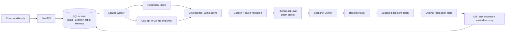

# Architecture and decisions

## Workflow outside, agent inside

Registration, approval, state transitions and execution policy are deterministic. The model chooses search/read actions and a proposed diagnosis inside a bounded investigation. It does not choose arbitrary host commands. This preserves autonomy where it helps exploration while keeping execution and evidence accounting inspectable.

Parallel source collectors are independent I/O tasks, not pretend model personas. A single reasoning agent consumes their structured evidence. Additional model agents should only be introduced after measured gains on a task dataset.

## Storage and recovery

SQLite WAL is chosen for a usable single-machine installation. Each connection enables foreign keys and a busy timeout. `BEGIN IMMEDIATE` makes approval, status transition and audit events atomic. A unique `(run_id, phase)` job key separates investigation and verification. Workers renew leases; after a crash an expired job becomes recoverable. A terminal run cannot transition back to active.

This is **at-least-once processing with isolated repeatable verification**, not exactly-once external execution. A crash can repeat a model request or create another snapshot. There are no automatic pushes, deployment mutations or writes to the source repository. Scaling to several hosts requires a shared database/queue and stronger fencing around external effects.

An expired heartbeat cannot renew its lease even before reassignment. Worker error handling retains the same fencing context as normal writes. Verification completion, its audit events, and verified memory commit in one transaction; cancellation wins or completion wins without an intermediate memory-only state.

## Evidence and retrieval

The index combines BM25 (identifiers/error strings) and character n-gram TF-IDF cosine (lexical variation), then RRF. The second channel is explicitly not a pretrained embedding model. Sources include path, line range, content and SHA256. File filtering, symlink rejection, containment checks and redaction are reused for direct reads. Git and GitHub connectors are read only and bounded.

Git collection requires a standalone `.git` directory. A worktree root check alone does not constrain gitdir/commondir/alternates to that root: this was reproduced with separate synthetic repositories. Gitfiles, shared metadata pointers, links and special files are therefore rejected before invoking Git; this deliberately excludes linked worktrees and submodule history collection.

## Execution boundary

The default project runner is Docker with explicit network/resource restrictions. Docker availability is not inferred from an installed CLI. The local runner is reserved for explicitly trusted repositories and the bundled fixture: a subprocess and temporary directory do **not** provide a security sandbox. Model patches cannot change tests, lockfiles, repository metadata or secrets. Exact replacements must match once. Original files remain untouched.

Approvals include the frozen patch digest. Source fingerprints prevent applying an approved patch to silently changed inputs. Verification requires an originally failing suite followed by a passing suite; pass→pass is not a demonstrated fix, and one passing target test with other failures is not success.

Unittest/pytest are launched through a separate observer outside the source snapshot, with a read-only observer mount under Docker. Completion records include test identities and outcomes. Stdout summaries are not trusted as verification evidence: an implementation that prints an invented success summary and exits immediately yields no complete observer report. The observer shares a Python interpreter with the tests, so this is not cryptographic attestation against fully adversarial reflection or monkey-patching. Unsupported commands can execute but remain unverified.

## Evaluation boundary

Offline harness cases use oracle candidates to test the verifier and policy layer. Their pass rate is not Agent repair accuracy. Actual provider runs report observed tool calls, token usage, outcome and limitations separately. Test data and provider responses must never be promoted into fabricated production adoption metrics.

## Current scope

One local owner; no multi-tenant RBAC, Kubernetes scheduler, production distributed queue or general shell Agent. Docker images must contain project test dependencies; the runner does not fetch packages during verification. GitHub ingestion uses the user's local `gh` read access and only runs for an explicitly registered repository.
