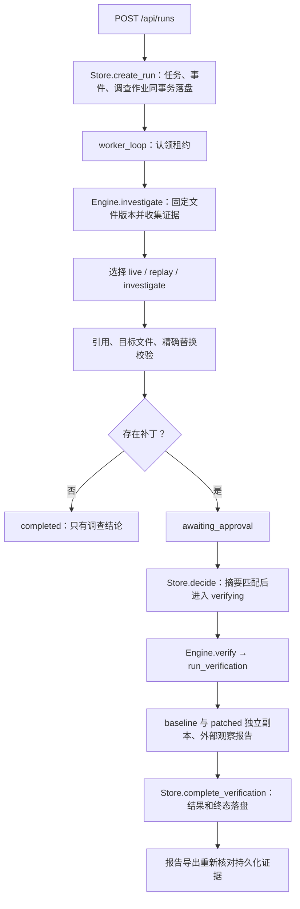

# 沿着一次任务读懂 TraceForge

先弄清一条任务怎样获得“已验证修复”的结论，再去记技术栈。这里的核心是：证据属于哪份源码，用户批准了哪份补丁，测试实际执行了什么，以及这些判断能否在重启后继续成立。

可以用内置结算案例贯穿阅读：`calculate_total` 只累计单价，遗漏了商品数量。[pricing.py](../examples/checkout-service/pricing.py#L5) 是有意保留的错误实现，[test_pricing.py](../examples/checkout-service/test_pricing.py#L6) 给出业务断言。离线演示的候选补丁由固定脚本提供；测试确实执行，模型没有参与。不要直接修改这个内置样例来演示“修好了”：回放会校验其指纹，真正的改动发生在验证副本里。



**从入口找到任务，而不是直接跳进模型调用。**

打开 [api.py 的 `create_run`](../traceforge/api.py#L228)。这个接口接收 [RunCreate](../traceforge/models.py#L25)，检查项目是否存在、live 配置是否齐全、replay 是否指向内置样例，然后调用 Store。它不会在 HTTP 请求里等待调查和测试完成。

项目的 `root`、`test_command`、`runner`、`trusted` 来自 [ProjectCreate](../traceforge/models.py#L8) 和 [API `create_project`](../traceforge/api.py#L202)。模型没有设置任意测试命令的工具；用户注册的命令与模型提出的源码替换属于不同权限。

[Store.create_run](../traceforge/store.py#L184) 在一次事务中写入 `runs`、`run.created` 事件和 `jobs` 的 `investigate` 作业。传入 `Idempotency-Key` 时，同一个 key 和同样的请求返回原任务；同一个 key 换了请求内容会冲突。这回答的是“用户重试有没有创建第二个任务”，并不保证一次模型请求永不重发。

[Store.transaction](../traceforge/store.py#L113) 使用 `BEGIN IMMEDIATE`，发生异常就回滚。阅读时关注哪些写入在同一事务里，不能只看到使用 SQLite 就认为所有状态天然一致。

**任务的状态和 worker 的工作阶段是两件事。**

[worker_loop](../traceforge/api.py#L40) 从 [Store.claim_job](../traceforge/store.py#L284) 认领作业，按 `jobs.phase` 调用 `Engine.investigate` 或 `Engine.verify`。`jobs` 保存 owner、租约到期时间和尝试次数；`runs.status` 表示用户能看到的业务状态；`state.phase` 则记录更细的检查点，例如 `model_call`、`tool_completed`。

等待审批时，没有后台模型一直循环。调查已经结束，状态停在 `awaiting_approval`；批准操作才会添加 `verify` 作业。

租约需要解决的真实问题是：旧 worker 卡住，新 worker 接管，旧 worker 随后又带着结果回来。[Store.fenced_job](../traceforge/store.py#L124) 将当前 owner 放入上下文，[Store._check_fence](../traceforge/store.py#L133) 在相应写入前重新检查 owner、状态和租约；[renew_job](../traceforge/store.py#L304) 也不允许已经过期的租约靠心跳复活。它防止旧 worker 覆盖新状态，但崩溃后仍可能重发模型请求或重建验证副本，所以这是至少一次处理，不是 exactly-once。

**调查先确定版本，再收集材料。**

[Engine.investigate](../traceforge/engine.py#L90) 建立索引，取得 [repository_manifest](../traceforge/runner.py#L92)，把相对路径到完整文件 SHA256 的映射保存到 `state.source_manifest`。恢复任务时会与旧清单比较；已经保存的空 `{}` 也是一个确定版本，不能当成“还没有清单”。

[Engine._collect](../traceforge/engine.py#L165) 收集代码、输入症状、Git 和用户选择启用的 GitHub 信息。代码和日志视图共享一次仓库搜索；Git 等独立读取并行进行。这里的 `specialist.*` 事件表示取证任务，不是多个模型角色。

查具体材料怎样形成，可以顺着这几个入口：

| 入口 | 阅读时要确认的事情 |
| --- | --- |
| [RepositoryIndex.build](../traceforge/retrieval.py#L273) | 哪些路径、链接和文件类型不会进入索引，文件更新和删除如何反映到索引 |
| [RepositoryIndex.search](../traceforge/retrieval.py#L371) | BM25、字符 n-gram TF-IDF 和 RRF 怎样产生排序；它们都是词法方法 |
| [RepositoryIndex.read](../traceforge/retrieval.py#L435) | 路径如何规范化，行号与内容长度如何限制，证据怎样绑定完整文件哈希 |
| [collect_git_evidence](../traceforge/connectors.py#L153) | 历史与工作区信息怎样只读提取，外指 Git 元数据为什么会被拒绝 |
| [collect_github_evidence](../traceforge/connectors.py#L213) | GitHub 信息的启用条件与读取范围 |

**把这些数据分开，才能解释后面的检查。**

| 数据 | 用途 | 不能据此得出的结论 |
| --- | --- | --- |
| `state.evidence` | 保存已取证、已脱敏的内容及来源、路径、行号、ID；`partial_line` 表示超长行只展示了一部分 | 有引用就一定找到了根因 |
| 仓库证据的 `sha256` | 对应观察时完整文件的字节版本 | 等同于证据片段的 ID |
| `state.source_manifest` | 固定调查与后续验证应使用的文件集合和版本 | 等同于用户批准的补丁内容 |
| `state.agent_messages` | live 的协议消息及继续请求所需内容，恢复和压缩时使用 | 运行详情接口会公开它；`public_run` 会过滤该字段 |
| `state.seen_evidence_ids` | 记录已经放入模型请求上下文的证据 ID，限制最终引用范围 | 模型一定理解或正确使用了这条证据 |
| `state.diagnosis` | 保存结构化结论、限制和 `patches` | 模型自报的 `confidence=high` 就是验证成功 |
| `state.patch_digest` 与 `state.approval` | 将批准动作绑定到确定的补丁列表 | 源码在审批之后不会变化 |
| `state.verification` | 保存两侧退出码、观察结果、差异与判定 | `status=completed` 就必然 `regression_fixed=true` |

[make_evidence](../traceforge/retrieval.py#L165) 的 ID 由来源、路径、行号和内容构成；仓库证据另外带着完整文件 SHA256。两个版本可能在同一行提供完全相同的片段，因此版本校验不能只比证据 ID。

**live 中，模型选择取证动作；执行器仍控制动作的含义。**

[Engine._live](../traceforge/engine.py#L426) 是唯一的推理循环。[tool_definitions](../traceforge/provider.py#L149) 只提供 `search`、`read`、`finish`；[OpenAIProvider.complete](../traceforge/provider.py#L196) 负责已配置协议的 HTTP 请求、有限重试、输出预算和用量事件。API 类型由配置决定，不会因为一次请求失败就默默切换服务。

循环每次调用前检查取消、租约、时间、上下文和已记录的 Token 用量，把步骤及消息保存为检查点。收到工具调用后，Engine 自己解析并校验参数，再调用索引；模型给出一个工具名并不意味着它有权执行同名主机程序。

参数错误可产生 `tool.rejected`，作为工具结果返回给模型修正；文件版本不一致属于 `EvidenceVersionError`，会终止本次调查。普通文本回答不能代替通过 `finish` 提交的结构化结论。累计 Token 约束依赖提供方返回的 usage，并在响应后阻止继续超支；它不是对未知服务账单的绝对上限保证。

[Engine._compress_messages](../traceforge/engine.py#L354) 超过上下文预算时保留原症状、已展示证据的目录，以及最近完整的模型调用和工具返回。压缩不能把一次调用与其返回拆散，也不编造模型隐藏思考。事实内容可以要求模型重新 `read`，协议续接内容则必须保留其原本语义。

`replay` 在 [Engine._replay](../traceforge/engine.py#L213) 按内置样例指纹生成已知补丁；`investigate` 在 [_retrieval_only](../traceforge/engine.py#L206) 返回材料集合并明确写“未确认”。二者均没有模型请求，不能用于展示模型的自主修复能力。

**引用检查要回答“存在、见过、同版本、对应目标”四个问题。**

[Engine._validate](../traceforge/engine.py#L270) 先用 [Diagnosis / Patch](../traceforge/models.py#L39) 做严格结构校验，再检查诊断与补丁引用的 ID 是否存在；live 还要求引用已进入模型上下文。每个补丁必须引用该目标文件的当前仓库证据，不能拿 Git 历史片段冒充当前源码。

[Engine._require_evidence_versions](../traceforge/engine.py#L238) 将仓库证据的路径和 SHA256 绑定到调查清单；[_require_message_versions](../traceforge/engine.py#L254) 还会核对恢复消息中的历史 user/tool 证据。Git、GitHub 和用户症状描述的是其他来源，不会硬套当前源码的文件哈希。

这里有一个值得现场画出来的失败模式：

```text
调查开始：文件 A，保存 manifest(A)
工具读取：文件临时变为 B，read 返回 B 的证据
读取结束：文件恢复 A
调查结束：manifest(A) 与开始时一致
```

只做前后清单比较会漏掉中间的 B。当前实现会在工具证据进入下一次模型请求前核对其哈希；即使磁盘已经恢复 A，B 的证据仍会使本次任务以 `source_changed` 失败。另一个恢复场景是旧工具消息仍含 B，但证据目录被新一次读取覆盖为 A；这正是还要检查历史消息的原因。该检查保证版本可追溯，不保证根因推理正确。

**审批绑定内容，验证重新检查执行前提。**

诊断通过后，Engine 使用 [patch_digest](../traceforge/store.py#L23) 对规范 JSON 的完整补丁列表计算 SHA256。有补丁才进入 `awaiting_approval`；无补丁可以直接完成调查。

[API approve](../traceforge/api.py#L291) 将决定和摘要交给 [Store.decide](../traceforge/store.py#L264)。后者在同一事务里检查当前状态、保存摘要和重新计算的摘要，再写批准记录、状态事件以及唯一的 `verify` 作业。过期内容和重复批准返回冲突。

[Engine.verify](../traceforge/engine.py#L543) 不盲信“队列里有 verify”。它重新检查 `verifying` 状态、持久化的批准决定、补丁摘要、引用和版本，把调查清单通过 `_expected_manifest` 传给 runner。这种重复检查保护的是恢复和内部调用路径；绕过 HTTP 接口也不能自动获得执行资格。

**两份代码都跑了测试，还需要证明跑的是正确的两份代码。**

[run_verification](../traceforge/runner.py#L579) 重新取得源清单并与调查清单比较，经 [_snapshot](../traceforge/runner.py#L119) 建立 `baseline` 和 `patched` 两个副本。补丁只写入 `patched`；[validate_patch](../traceforge/runner.py#L53) 要求仓库内安全路径、允许的实现文件、非空且唯一出现的 `before`，并拒绝测试和锁文件等目标。

测试命令在 [snapshot_test_command](../traceforge/runner.py#L449) 中按有限参数集合解析。仓库内绝对目标映射成快照相对路径；pytest 的 `pythonpath` 相对配置文件目录，其他配置按各自语义解析。不能只把 `cwd` 改到临时目录，就假定绝对路径和 editable 安装不会导回原仓库。

[observed_command](../traceforge/runner.py#L462) 启动仓库外的 [test_observer.main](../traceforge/test_observer.py#L267)。[SnapshotImports.check](../traceforge/test_observer.py#L64) 核对实际项目模块来源；[unittest_case / test_callable](../traceforge/test_observer.py#L106) 还检查实际继承方法及被补丁修改的测试钩子。`checks.py` 这样的普通文件名也可能真正定义测试，光看文件名黑名单不够。

[run_unittest](../traceforge/test_observer.py#L171) 和 [run_pytest](../traceforge/test_observer.py#L224) 从测试框架的结果回调记录身份与结果。观察器完整结束后才写完成报告；打印“OK”或 `os._exit(0)` 无法替代这份报告。[read_observation](../traceforge/runner.py#L477) 校验其结构、退出码、身份与计数，[assess_regression](../traceforge/runner.py#L544) 再要求真实失败基线、补丁后通过、保留原测试身份且没有新增跳过。

[parse_test_counts](../traceforge/runner.py#L511) 仍会解析 stdout/stderr，但结果是 `output_summary`，仅用于展示。判定使用的是观察器报告。这里必须能说清 `tests` 和 `output_summary` 为什么同时存在。

Docker 参数由 [_docker_command](../traceforge/runner.py#L211) 构建，限制网络和资源，并分开挂载观察器与报告目录。local 只允许显式可信仓库；它不是隔离未知代码的沙箱。观察器和被测 Python 共享解释器，不能把普通来源核对宣称为抵抗任意反射或 monkey-patching 的证明。

普通仓库只运行用户注册的测试命令。额外的预设隐藏测试属于 [benchmark](benchmark.md)，不会自动给每个接入仓库生成一套隐藏断言。

**完成、记忆和导出分别承担不同职责。**

[Store.complete_verification](../traceforge/store.py#L331) 把结果、`completed` 状态、完成事件以及符合条件的记忆放进同一个事务。验证运行结束但没有证明修复，也可以是 `completed`；只有 `regression_fixed=true` 才写修复记忆。记忆目前供人审阅，不会自动注入下一次模型推理，更不等于训练了模型。

[API report](../traceforge/api.py#L250) 先调用 [Store.report_snapshot](../traceforge/store.py#L208)，在同一个 SQLite 读快照里取得任务、项目和有界事件头，避免导出时混用不同提交的状态。

[build_report](../traceforge/reports.py#L296) 使用白名单组织可携带内容；[_verified](../traceforge/reports.py#L238) 重新核对审批、观察报告与回归条件，[_persisted_provenance](../traceforge/reports.py#L172) 进一步核对持久化的调查／验证清单、证据和引用。旧记录缺失必要字段时，报告会说明无法确认，不能直接照抄历史 `regression_fixed=true`。

导出报告含证据索引、版本摘要、补丁内容哈希与结果，不含源码正文、补丁原文、测试原始输出或 provider 续接消息。[render_markdown](../traceforge/reports.py#L385) 负责可阅读表示。`content_sha256` 校验的是规定格式的 JSON 内容，既不是 Markdown 文件哈希，也不是签名或第三方背书。导出只读取持久记录，不会因为用户后来编辑了工作区就重新运行调查。

下面三个练习直接使用仓库已有测试。先按 README 安装开发依赖，在仓库根目录执行；命令是练习入口，本文不预填通过数量。它们使用临时目录、可信合成代码或替身 provider，不需要真实模型账号。若要改输入，只在自己的练习分支改下面指定的测试值，保留断言并先预测结果；不要修改内置回放夹具或削弱执行门禁。

**练习一：同一个批准按钮，为什么能被拒绝两次。**

阅读 [test_approval_digest_gate_via_api](../tests/test_api.py#L54) 和 [test_replay_approval_and_real_fix](../tests/test_engine.py#L31)，再运行：

```powershell
.venv\Scripts\python.exe -m pytest -vv tests/test_api.py::test_approval_digest_gate_via_api tests/test_engine.py::test_replay_approval_and_real_fix
```

API 用例先人为准备待审批状态，再依次提交错误摘要、正确摘要和重复批准；它只验证 API 门禁，不包含一次模型调查。Engine 用例则用固定 replay 补丁串起真实取证、审批、快照测试与记忆，并检查样例原文不变。

可改动的输入是 API 用例中 `patches` 的 `reason`，例如从 `proof` 改成 `reviewed locally`。摘要由测试重新计算，所以正确摘要仍应被接纳；若保留改动前的摘要提交，就应冲突。解释时指出：摘要绑定完整补丁对象，包含理由与引用，不只是 `before/after`。最后回答：错误摘要与重复批准分别违反了哪个条件，为什么不能把这两个拒绝都解释为网络重试失败。

**练习二：文件已恢复原样，为什么调查仍然失败。**

阅读 [test_transient_repository_revision_never_reaches_model](../tests/test_engine.py#L471)，再运行：

```powershell
.venv\Scripts\python.exe -m pytest -vv tests/test_engine.py::test_transient_repository_revision_never_reaches_model
```

这个用例分别走 `read` 和 `search`。它在真实索引读取前临时把 A 改成 B，读取后用 `finally` 恢复 A；替身 provider 只安排一次取证动作，不发网络请求。预期检查点是磁盘回到 A、瞬时证据属于 B、任务为 `failed/source_changed`，且 B 没进入下一次模型请求或修复记忆。

可将用例中的 `revision B` 改成另一个不同于 A 的注释，保留恢复动作与断言。结果应保持同样的拒绝语义，说明检查依赖文件哈希而非某个固定字符串。现场画出 A → B → A，再指出只在调查末尾比较 manifest 为什么会漏检。

**练习三：继承来的断言，被改在哪里也算修改测试。**

阅读 [test_unittest_inherited_test_method_protects_actual_definition](../tests/test_runner_snapshot.py#L330)，再运行：

```powershell
.venv\Scripts\python.exe -m pytest -vv tests/test_runner_snapshot.py::test_unittest_inherited_test_method_protects_actual_definition
```

临时项目的 `main.answer()` 返回错误的 `1`，`checks.py` 定义断言应为 `2` 的基类方法，`test_main.Test` 只继承它。`change_test=False` 修复 `main.py`；`change_test=True` 把 `checks.py` 中断言的期望值从 `2` 改为 `1`。两条路径都可能让 unittest 本身结束为绿色，但只有前者应获得验证成功。

可将临时基类 `SharedAssertions` 改名，同时修改生成的子类引用，保留行为与断言。观察器不应依赖这个类名。解释时跟到 `type(test).__module__` 与实际方法 `__code__.co_filename` 的区别：前者仍是 `test_main`，后者才能找到定义断言的 `checks.py`。顺带说清“允许补丁文件名”与“允许修改实际测试定义”为什么需要两层判断。

读懂这些练习后，再决定要改哪一层：调整证据排序去 `retrieval.py`；新增模型工具要同时改 provider 的工具 schema、Engine 分派与验证；调整批准语义先看 Store 事务；扩展测试框架要提供可靠的观察报告；增加报告字段要决定是否可携带、是否需要脱敏以及旧记录怎样解释。每次改动先明确哪条现有保证可能失效，再挑对应回归用例，而不是只看页面能否显示。

目前项目只有一个推理 Agent，取证并发不是多 Agent；已完成的真实模型修复与十案例基准见 [验收记录](acceptance.md)。新调查在 `_live` 中保存请求模型、协议与接口摘要，恢复时配置改变会阻止续接旧工具历史，密钥轮换不受影响；报告仅导出模型和协议。Oracle、replay 和替身 provider 的结果仍与 live 分开。内置案例与隐藏断言也不代表生产用户、跨仓库修复率或业务收益。讲述时把结论停在自己能打开源码、解释条件并复现的范围内。
