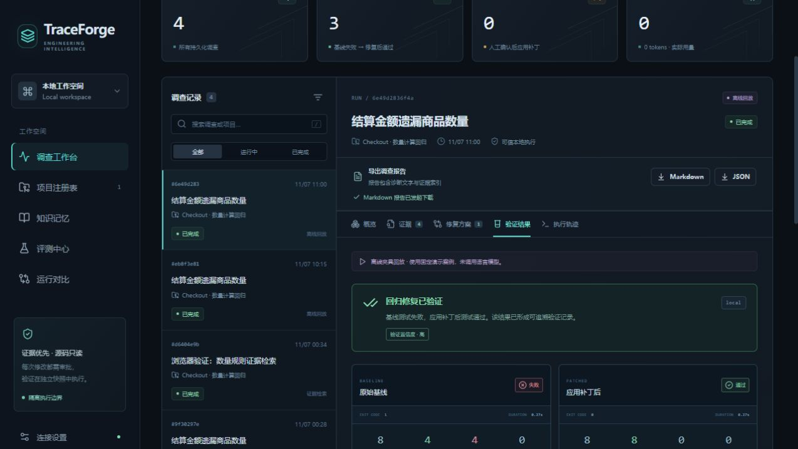

# 调查报告

在任意调查详情的“导出调查报告”区域，可下载 Markdown 或 JSON。排队、调查中、失败和已完成的任务均可导出；报告明确记录导出所对应的状态，未完成任务不会显示为已验证修复。

Markdown 适合现场讲解或事故复盘，JSON 适合检查摘要与自动归档。下载到本机不会向 GitHub、模型服务或其他站点发送报告。

本次浏览器实测下载的样例：[Markdown](evidence/sample-run-report.md)、[JSON](evidence/sample-run-report.json)。它们来自同一次固定样例回放，外部观察器记录 4 项失败 → 8 项通过；模型调用为 0。JSON 摘要已独立复算一致，见 [下载验收摘要](evidence/report-download.json)。

新增来源核验后的 HTTP 验收样例见 [当前 Markdown](evidence/current-run-report.md) 和 [当前 JSON](evidence/current-run-report.json)，包含 `verification.provenance`；对应的[接口验收记录](evidence/api-smoke-final.json)保存了复算结果。

真实模型的浏览器下载样例见 [live Markdown](evidence/live-run-report.md) 和 [live JSON](evidence/live-run-report.json)。新增 `provider.requested_model` 与 `api_style` 取自调查时保存的配置，不从当前服务配置反推历史，也不证明网关实际使用的底层模型。Markdown 分开列出诊断阶段的原始限制与后续验证限制，避免把“当时尚未测试”误读为当前执行状态。

## 包含哪些信息

- 任务名称、输入现象、模式、状态与时间。
- 诊断、限制、证据 ID、相对路径、行号与内容摘要。
- 候选补丁的理由、引用及前后内容 SHA256；审批所绑定的补丁摘要与决定。
- 基线与补丁后的退出码、耗时、外部观察器测试计数及验证结论。
- 已记录的模型请求与 Token 计数，以及最近最多 1000 条事件的时间和类型。

报告不包含源码正文、原始补丁内容、测试 stdout/stderr、执行命令、绝对项目根目录、事件 payload、模型内部续接数据。需要代码差异时，仍可从验证结果单独下载 `.patch`。

**诊断文字、项目名称与相对文件名仍可能包含业务信息。** 自动脱敏不等同于匿名化，分享前应检查报告正文。Markdown 中的外部图片、链接和 HTML 按文本转义处理，不应作为主动内容执行。

## 口径

离线回放会注明候选补丁来自固定样例；检索模式不会宣称模型确认根因；live 单次记录也不是模型准确率。未返回的 usage 不会被解释为零费用。

“已验证修复”重新检查完整的回归证据、任务完成状态和审批绑定；仅有 `regression_fixed=true` 的旧记录不能绕过外部观察器检查。还会核对持久化的调查与验证文件清单、仓库证据版本及诊断/补丁引用。旧记录缺少这些元数据时明确显示未证实，不能从当前磁盘反推历史状态。

`verification.provenance` 包含两份文件清单的摘要、一致性与引用核验结果，不导出清单中的无关路径。超长单行证据保留 `partial_line`，Markdown 明示“部分行片段”。观察器与测试共享 Python 解释器这一限制仍明确保留。

## 一致性与校验

后端用同一个 SQLite WAL 只读事务读取任务、项目和事件边界。读事务期间新提交的状态与事件留给下一次导出，避免“旧状态配新事件”的混合报告。事件超过上限时保留最近的 1000 条并注明截断；证据有上限时优先保留诊断与补丁所引用的项。

JSON 的 `content_sha256` 是去掉该字段后，用 UTF-8 编码的规范 JSON 的 SHA256，规范化使用 `ensure_ascii=False`、`sort_keys=True`、`separators=(',', ':')`。Markdown 中显示的是同一份 JSON 的摘要，而不是 Markdown 文件字节的摘要。它用于检查内容一致性，**不是数字签名、时间戳认证或外部审计证明**。

API：`GET /api/runs/{id}/report?format=markdown` 或 `format=json`。下载沿用工作台 Token 权限，并设置 `Cache-Control: no-store`。导出不会修改任务、审批、记忆或审计事件。
