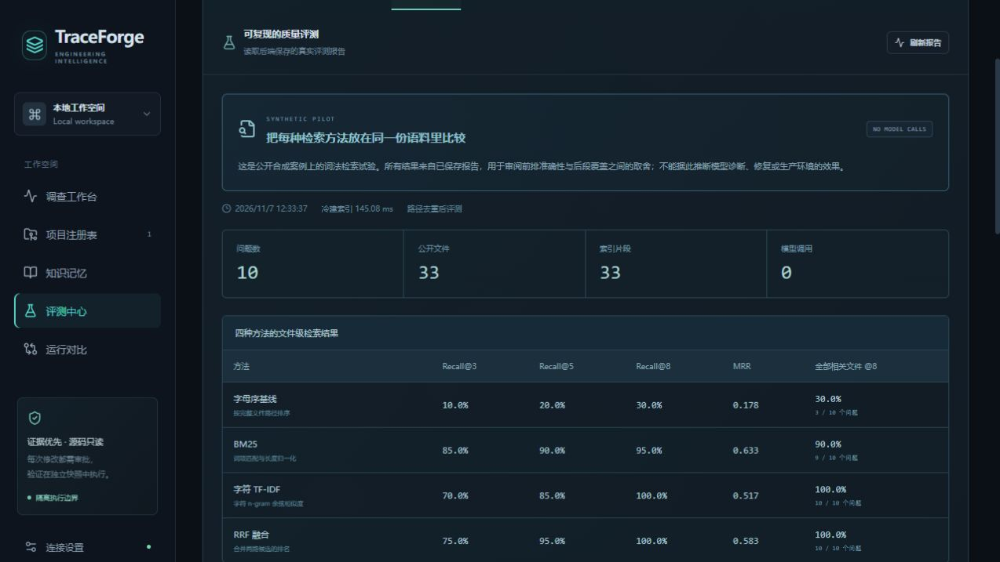

# 检索消融：融合是否真的有收益

这项评测比较生产检索入口的 BM25、字符 n-gram TF-IDF cosine、RRF 和按路径字母排序的基线。它不调用模型、不执行候选代码，也不评价修复成功率。

在仓库运行：

```powershell
.venv\Scripts\python.exe -m traceforge retrieval-evaluate
```

结果写到 `.traceforge/retrieval-evaluation.json`。控制台“评测中心 → 检索消融”可读取它；API 为 `GET /api/retrieval-evaluation`。独立安装 wheel 后同样可运行，不依赖本地源码目录。



## 为什么重新设计检索评测

原多故障基准的每个工作区只有 4–6 个文件，初始 Top-8 很容易覆盖全部相关路径；查询又来自工作区内的 `PROBLEM.md`。在只读实验中，按字母排序或使用无关查询也得到 10/10 覆盖。因此该数字只能说明小工作区的取证入口工作，不能支持排序质量优秀的结论。

新 pilot 把十个公开工作区合并成 33 个文件、33 个块的语料。各工作区放在稳定的 `repo000` 等中性目录中，相互提供干扰文件。题面、相关性标签、hidden、oracle 和敏感路径都不进入索引。查询仍使用公开题面，相关路径标签来自公开 `case.json`；评测代码不会读取隐藏测试或预设补丁。

## 本机实测结果

2026-11-07，10 个问题，每个问题标注 2 个相关路径，所有方法使用同一语料与分母。完整逐案例排名、数据摘要和耗时见 [原始报告](evidence/retrieval-ablation.json)。

| 方法 | Recall@3 | Recall@5 | Recall@8 | MRR | 全部相关路径命中@8 |
| --- | ---: | ---: | ---: | ---: | ---: |
| 字母排序 | 0.10 | 0.20 | 0.30 | 0.1783 | 3/10 |
| BM25 | 0.85 | 0.90 | 0.95 | 0.6333 | 9/10 |
| 字符 TF-IDF | 0.70 | 0.85 | 1.00 | 0.5167 | 10/10 |
| RRF | 0.75 | 0.95 | 1.00 | 0.5833 | 10/10 |

本组数据中，RRF 补回了 BM25 在 Top-8 漏掉的路径，但 BM25 的前排排序更好。不能据此声称融合全面优于单路，也没有为得到更漂亮的指标修改生产默认参数。

## 指标与复现约束

- 先对完整相对路径去重，再截取 Top-k；不同工作区的同名文件不会合并。
- 单问题 Recall@k = Top-k 命中的相关路径数 / 该问题的全部相关路径数；表中是十个问题的宏平均。
- MRR 是首个相关路径排名倒数的宏平均；没有返回相关路径时为 0。返回证据上限为 50，MRR 也受此上限约束。
- 全部命中只在该问题所有相关路径都进入 Top-k 时计 1；拒答案例也保留在检索分母里。缺失标注文件直接使评测失败，不能静默删掉难例。
- 三种检索方法共用生产分块、父上下文展开、去重和每路 200 候选上限。RRF 的常数为 60；BM25、字符 n-gram 和分块参数全部保存在报告中。
- 数据清单、查询和标签分别计算 SHA256。排名与哈希重复运行一致；耗时与生成时间不要求一致。结果通过临时文件与原子替换落盘，失败不覆盖上次完整结果。

耗时只是一轮本机实验，每个方法每题执行一次，包含生产查询的磁盘新鲜度检查。文件缓存和固定执行顺序会影响数值；这里的 p95 不代表生产尾延迟或压测结果。

## 已知不足与下一步

这仍是同一套合成案例衍生的小语料，没有独立留出集、真实事故数据、统计置信区间或神经向量对照。下一步应收集带日期与版本的真实故障，按故障家族划分开发/留出集合，再评价拼写变化、中文症状、长日志和无答案查询。当前结果只支持上表的有限比较。

长日志本身另有回归覆盖：6000 字符分块不再静默舍弃后续行；超长单行使用有重叠的窗口，并在模型、界面和导出报告里注明“部分行”。它解决索引覆盖问题，不等同于这十题的排序指标提升。
